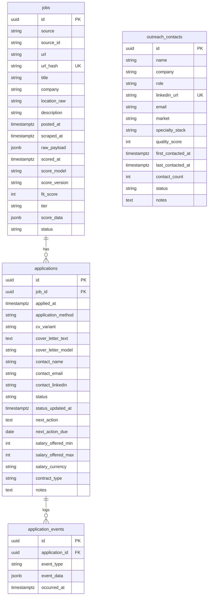

# Data Model

This document describes the database schema for the Job Hunter EU project.

## ER Diagram



## Tables

### `jobs`

The central entity of the system. It stores job offers ingested from various sources, enriched with scoring data.

| Column | Type | Description |
|---|---|---|
| `id` | `UUID` | Primary key, auto-generated using `gen_random_uuid()`. |
| `source` | `VARCHAR(50)` | The source of the job offer (e.g., 'arbeitnow', 'remoteok'). |
| `source_id` | `VARCHAR(255)` | Original ID from the source, if available. |
| `url` | `TEXT` | Full URL to the job offer. |
| `url_hash` | `VARCHAR(64)` | SHA256 hash of the canonical URL, used for deduplication (UNIQUE). |
| `title` | `TEXT` | Job title. |
| `company` | `TEXT` | Company name. |
| `location_raw` | `TEXT` | Location as provided by the source. |
| `description` | `TEXT` | Full job description. |
| `posted_at` | `TIMESTAMPTZ` | When the job was posted (if available). |
| `scraped_at` | `TIMESTAMPTZ` | When the job was ingested (defaults to `now()`). |
| `raw_payload` | `JSONB` | Original data received from the source. |
| `scored_at` | `TIMESTAMPTZ` | When the job was scored by the AI. |
| `score_model` | `VARCHAR(50)` | AI model used for scoring. |
| `score_version` | `VARCHAR(20)` | Version of the scoring prompt. |
| `fit_score` | `INTEGER` | Numerical score (0-100). |
| `tier` | `VARCHAR(10)` | Category based on score ('A', 'B', 'C', 'REJECT'). |
| `score_data` | `JSONB` | Structured output from the scoring AI. |
| `status` | `VARCHAR(30)` | Current status in the pipeline (defaults to 'new'). |

#### Indices

* `idx_jobs_status`: On `status`.
* `idx_jobs_tier`: On `tier`.
* `idx_jobs_scraped_at`: On `scraped_at DESC`.
* `idx_jobs_company`: On `company`.
* `jobs_url_hash_key`: UNIQUE constraint on `url_hash`.

### `applications`

Represents an application submitted for a job.

| Column | Type | Description |
|---|---|---|
| `id` | `UUID` | Primary key. |
| `job_id` | `UUID` | Foreign key to `jobs.id`. |
| `applied_at` | `TIMESTAMPTZ` | When the application was submitted. |
| `application_method` | `VARCHAR(50)` | Method used (e.g., 'web_form', 'email'). |
| `cv_variant` | `VARCHAR(50)` | CV version used. |
| `cover_letter_text` | `TEXT` | Full text of the cover letter. |
| `cover_letter_model` | `VARCHAR(50)` | LLM model used for the cover letter. |
| `contact_name` | `TEXT` | Name of the contact person. |
| `contact_email` | `TEXT` | Email of the contact person. |
| `contact_linkedin` | `TEXT` | LinkedIn URL of the contact person. |
| `status` | `VARCHAR(30)` | Current application status (defaults to 'applied'). |
| `status_updated_at` | `TIMESTAMPTZ` | Last time the status was updated. |
| `next_action` | `TEXT` | Description of the next step. |
| `next_action_due` | `DATE` | Deadline for the next action. |
| `salary_offered_min` | `INTEGER` | Minimum salary offered. |
| `salary_offered_max` | `INTEGER` | Maximum salary offered. |
| `salary_currency` | `VARCHAR(10)` | Currency code. |
| `contract_type` | `VARCHAR(20)` | e.g., 'B2B', 'EOR', 'employee'. |
| `notes` | `TEXT` | Additional notes. |

#### Indices

* `idx_apps_status`: On `status`.
* `idx_apps_next_action_due`: Partial index on `next_action_due` excluding terminal states.

### `application_events`

Audit log for application-related events.

| Column | Type | Description |
|---|---|---|
| `id` | `UUID` | Primary key. |
| `application_id` | `UUID` | Foreign key to `applications.id`. |
| `event_type` | `VARCHAR(50)` | Type of event (e.g., 'status_change'). |
| `event_data` | `JSONB` | Structured data about the event. |
| `occurred_at` | `TIMESTAMPTZ` | When the event occurred. |

#### Indices

* `idx_events_app`: On `application_id` and `occurred_at DESC`.

### `outreach_contacts`

Represents a contact for proactive outreach.

| Column | Type | Description |
|---|---|---|
| `id` | `UUID` | Primary key. |
| `name` | `TEXT` | Name of the contact. |
| `company` | `TEXT` | Company name. |
| `role` | `TEXT` | Job title or role. |
| `linkedin_url` | `TEXT` | LinkedIn profile URL (UNIQUE). |
| `email` | `TEXT` | Email address. |
| `market` | `VARCHAR(50)` | Targeted market. |
| `specialty_stack` | `VARCHAR(100)` | Tech stack specialty. |
| `quality_score` | `INTEGER` | Quality score (1-5). |
| `first_contacted_at` | `TIMESTAMPTZ` | Date of first contact. |
| `last_contacted_at` | `TIMESTAMPTZ` | Date of last contact. |
| `contact_count` | `INTEGER` | Number of times contacted. |
| `status` | `VARCHAR(30)` | Current outreach status (defaults to 'new'). |
| `notes` | `TEXT` | Additional notes. |

#### Indices

* `idx_outreach_followup`: Composite index on `status` and `last_contacted_at`.

## Views

### `weekly_metrics` (Materialized View)

Aggregated weekly metrics for the dashboard and digest.

| Column | Type | Description |
|---|---|---|
| `week` | `DATE` | Start of the week (Monday). |
| `apps_sent` | `BIGINT` | Total applications submitted during the week. |
| `apps_with_response` | `BIGINT` | Applications that received any response (not in 'applied', 'ghosted', 'withdrawn' status). |
| `interviews` | `BIGINT` | Applications that reached interview stage. |
| `offers` | `BIGINT` | Applications that resulted in an offer. |
| `avg_offer_max` | `NUMERIC` | Average maximum salary offered in that week. |

#### Indices

* `idx_weekly_metrics_week`: UNIQUE index on `week`.

## Enums

### `JobStatus`

* `new`: Ingested but not yet processed.
* `scored`: Evaluated by the AI.
* `queued`: Shortlisted for application.
* `applied`: Application submitted.
* `manual_review`: Needs human intervention.
* `rejected`: Not a good fit.
* `archived`: Old or no longer relevant.

### `JobTier`

* `A`: Excellent fit (Fit Score >= 80).
* `B`: Good fit.
* `C`: Average fit.
* `REJECT`: Poor fit.

### `ApplicationStatus`

* `applied`: Initial state after submitting.
* `screening`: Recruiter screen or initial chat.
* `interview_1`: First technical/cultural interview.
* `interview_n`: Subsequent interview rounds.
* `offer`: Received a job offer.
* `rejected`: Application was declined by the company.
* `ghosted`: No response for a significant time.
* `withdrawn`: Application withdrawn by the candidate.

### `ApplicationEventType`

* `status_change`: Record of a status update.
* `follow_up_sent`: Record of a follow-up action.
* `interview_scheduled`: Record of a newly scheduled interview.

### `OutreachMarket`

* `germany`: Germany market.
* `eu_wide`: EU Wide market.
* `uk`: UK market.
* `netherlands`: Netherlands market.
* `other`: Other markets.

### `OutreachStatus`

* `new`: New contact, not yet reached out.
* `contacted`: Initial outreach sent.
* `replied`: Contact replied.
* `ghosted`: No response after several attempts.
* `warm`: Contact is interested or helpful.

## Design Decisions

### Why JSONB?
We use `JSONB` for `raw_payload` in `jobs` and `event_data` in `application_events`. This allows us to store unstructured or semi-structured data from various job sources without constantly modifying the schema. `JSONB` is preferred over `JSON` because it is stored in a decomposed binary format, which makes it slightly slower to input but significantly faster to process, as it supports indexing.

### Why Partial Indices?
The `idx_apps_next_action_due` is a partial index:
```sql
CREATE INDEX idx_apps_next_action_due ON applications (next_action_due)
WHERE status NOT IN ('rejected', 'ghosted', 'withdrawn', 'offer');
```
This optimizes queries that look for pending actions. By excluding terminal statuses, we keep the index small and focused on the data that actually needs monitoring for follow-ups.

### Why UUIDs vs Serials?
We use UUIDs (v4) for all primary keys.
- **Benefits**: They are globally unique, allowing for easier data merges and distributed systems. They don't leak information about the number of records (unlike serials).
- **Implementation**: Generated in the database using `gen_random_uuid()`.

### Timestamps in UTC
All `TIMESTAMPTZ` columns store data in UTC. This ensures consistency across different timezones and avoids ambiguity during daylight saving transitions. Application logic should handle conversion to the user's local time if necessary.

## How to add a new table (Workflow)

1. **Define the Model**: Add a new SQLAlchemy class in `src/jobhunter/db/models.py` inheriting from `Base`.
2. **Import the Model**: Ensure the new model is imported in `alembic/env.py` so Alembic can detect it.
3. **Generate Migration**: Run `uv run alembic revision --autogenerate -m "Add table <name>"`.
4. **Review Migration**: Check the generated file in `alembic/versions/` for correctness.
5. **Apply Migration**: Run `uv run alembic upgrade head`.
6. **Update Documentation**: Add the new table description and update the ER diagram in `docs/data_model.md`.
